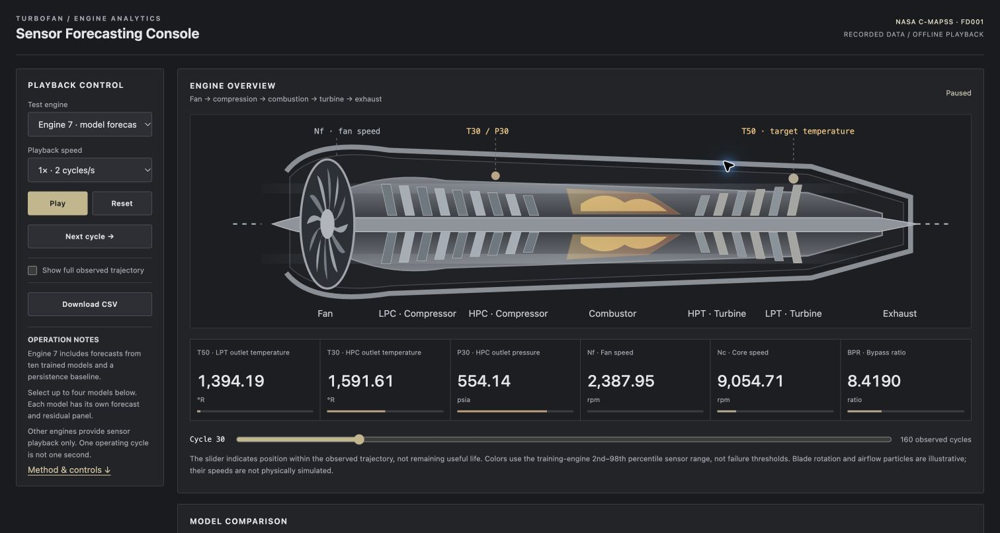

# Turbofan Sensor Forecasting, Python ML/DL Experiment

This project predicts the next observed T50 sensor value from 30 preceding engine cycles using NASA C-MAPSS FD001. It compares ten learned models with a persistence baseline. The Python experiment is the main work; the browser dashboard replays its stored results.

[Training and evaluation code](train.py), [English notebook](turbofan_sensor_forecasting.ipynb), [recorded model comparison](recorded_model_comparison.csv), [engine 7 forecast values](recorded_engine7_forecasts.csv).

[Open the live dashboard](https://mehmetkaramaan.github.io/turbofan-sensor-forecasting-dashboard/)

[](https://mehmetkaramaan.github.io/turbofan-sensor-forecasting-dashboard/)

## What the repository contains

`train.py` downloads the pinned dataset, prepares engine-level partitions, constructs windows, fits the ten models and evaluates their predictions. The notebook contains the same experiment with explanations and diagnostics. Models are fitted in Python using scikit-learn, XGBoost, CatBoost, LightGBM and TensorFlow/Keras.

`benchmark-data.json` contains recorded FD001 sensor values and stored forecasts for engine 7. `build.py` combines that data with `dashboard.template.html` to produce the self-contained `index.html`. JavaScript handles playback, plotting, CSV export and error calculation; it does not train or execute the learned models. The bundled forecasts are saved experiment outputs, not random noise or newly generated browser predictions.

The repository does not currently include fitted model checkpoints. Re-running the Python experiment is required to fit the models again. The dashboard is therefore a recorded-result viewer, not a live inference service. Other engines provide sensor playback without invented model forecasts. These boundaries also appear in the dashboard guide.

## Dataset and forecast target

FD001 contains one operating condition and high-pressure-compressor degradation. The official training file has 20,631 rows from 100 engines; the test file has 13,096 observed rows from another 100 engines. The dataset is read from the [Hugging Face mirror](https://huggingface.co/datasets/SoyVitou/NASA-C-MAPSS-Turbofan-Engine) at revision `4d14a0bf6248235bce31cbdacb297e03e0f75d52`. See the [NASA dataset description](https://data.nasa.gov/dataset/cmapss-jet-engine-simulated-data) for the original benchmark.

The target is low-pressure-turbine outlet temperature T50 at cycle t+1 in degrees Rankine (°R). Inputs are the preceding 30 cycles of 17 variable sensor/setting channels. Engine identity, cycle counter, RUL and split labels are excluded. Windows stay inside each engine; no target after the final observed cycle is invented. An operating cycle is not a second.

## Experimental design

Twenty whole training engines are reserved for validation using seed 42; the remaining 80 engines fit channel selection, scaling and model parameters. The official 100 test engines stay separate. This produces 13,990 training windows, 3,641 validation windows and 10,096 test windows. Preprocessing statistics are fitted on training engines only.

KNN, Decision Tree, Random Forest, Extra Trees, Gradient Boosting, XGBoost, CatBoost and LightGBM use flattened histories. MLP also flattens its input; SimpleRNN reads the ordered sequence. All models receive the same history. Persistence predicts the next temperature as the latest observed temperature.

MLP uses Flatten, Dense(64), Dense(32) and Dense(1). SimpleRNN uses SimpleRNN(32), Dense(16) and Dense(1). Both minimize standardized-target MSE with Adam, at most 35 epochs, batch size 128 and validation early stopping with patience 6. All other model settings are explicit in `train.py`.

## Recorded results

These values were extracted from the saved executed Kaggle notebook. They were not recomputed during repository cleanup. MAE and RMSE retain °R units; R² measures explained variation and is not classification accuracy. The table is sorted by test RMSE for reporting, while model selection uses validation RMSE.

| Model | Test MAE (°R) | Test RMSE (°R) | R² | Validation RMSE (°R) |
| --- | ---: | ---: | ---: | ---: |
| Extra Trees | 3.2941 | 4.1185 | 0.6314 | 4.1305 |
| Random Forest | 3.2959 | 4.1215 | 0.6309 | 4.1602 |
| CatBoost | 3.2940 | 4.1227 | 0.6307 | 4.1168 |
| XGBoost | 3.3020 | 4.1300 | 0.6294 | 4.1441 |
| LightGBM | 3.2984 | 4.1312 | 0.6292 | 4.1493 |
| Gradient Boosting | 3.3073 | 4.1369 | 0.6281 | 4.1463 |
| MLP | 3.4002 | 4.2559 | 0.6064 | 4.3466 |
| SimpleRNN | 3.4062 | 4.2623 | 0.6052 | 4.2572 |
| KNN | 3.4133 | 4.2629 | 0.6051 | 4.2623 |
| Decision Tree | 3.9378 | 4.9267 | 0.4726 | 5.0225 |
| Persistence | 4.5458 | 5.6698 | 0.3015 | 5.7100 |

CatBoost had the lowest validation RMSE, 4.1168 °R, and was selected before test interpretation. Its test RMSE was 4.1227 °R against persistence at 5.6698 °R, a 27.29% reduction. Extra Trees had the smallest reported test RMSE, 4.1185 °R, but that small difference does not establish a statistically reliable winner. One split and seed do not establish a universal model ranking.

Training time, prediction cost and equal-weight per-engine MAE remain available in `recorded_model_comparison.csv`. Those timings describe the saved environment and batching choices, not guaranteed deployment latency. Window observations overlap and are not independent samples.

## Run the experiment

```sh
python -m venv .venv
source .venv/bin/activate
python -m pip install -r requirements.txt
python train.py
```

The notebook can also run in Jupyter or Kaggle. Outputs include diagnostic figures, full-test predictions, metric tables, learning histories and an experiment manifest under `turbofan_outputs/`. The script evaluates fitted models but does not currently export their weights. Requirements are compatible ranges rather than the original environment lock; numerical results and timings can differ across software versions and hardware.

The English notebook retains the saved experiment's model settings. Its cached outputs were removed so that rerun outputs are not confused with the separately preserved results. `experiment_provenance.json` records the original source notebook hash and publication changes.

## Inspect and verify the stored forecasts

Engine 7 has 130 forecasts per model, covering observed target cycles 31 through 160. The downloadable `recorded_engine7_forecasts.csv` exposes the same values used by the demo, alongside observed T50. `data_artifact_manifest.json` identifies the data bundle and forecast table by SHA-256.

```sh
python verify_demo_data.py
```

This standard-library check verifies the artifact hashes, matches CSV forecasts to the JSON bundle and checks that persistence equals the preceding recorded measurement. It also verifies that the generated HTML contains the same payload. It does not independently reproduce model training or certify the origin of every saved prediction.

## Use the dashboard

Start with engine 7, then select one to four models. Each model has a separate forecast and residual panel. Play, pause, step or scrub through cycles; residuals and MAE/RMSE use only revealed target observations. The error interval can use all revealed history or the most recent 10, 30 or 60 cycles. Changing that interval does not change the trained models' 30-cycle input window.

The all-model table compares the same engine and interval; it does not change the number of visible panels. Sensor selection changes the standardized measurement plot. Other engine selections show six recorded channels without forecast panels. CSV exports contain revealed measurements and the selected stored forecasts.

The schematic engine, rotating fan, particles and flame illustrate the display; they do not solve combustion, thrust, efficiency or internal flow. Sensor colors use training-derived ranges, not diagnostic or safety thresholds. This task estimates next-cycle T50, not remaining useful life. A real engine monitoring system would require different validation and deployment work.

## Build the browser view

```sh
python build.py
python -m http.server 8000
```

Open `http://localhost:8000` or open `index.html` directly. GitHub's source-file preview cannot execute the page; use the GitHub Pages link above. The generated HTML is marked as generated in `.gitattributes`; the handwritten template remains part of the repository. Language percentages describe file sizes rather than which component performs training.
